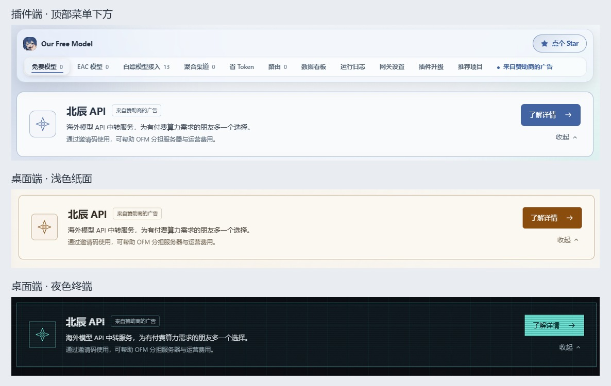

# 赞助广告横幅与详情页

两端取消每天自动弹出的赞助公告，改为各业务页面顶部的静态赞助横幅。原广告专页保留完整原文、图片、邀请码、群号及主动访问赞助商的链接。

## 展示与设计



- DSH 插件：横幅位于顶部导航与当前页面正文之间，由 Shell 统一渲染。
- 独立服务与桌面端：横幅位于管理页面公共内容区顶部，在 App 中渲染一次。模型、用量、渠道、接入、设置、广告专页均可见；登录页不展示广告。
- 插件沿用宿主配色；桌面浅色使用纸面与铜色，深色沿用青色终端配色。横幅随正文滚动，不悬浮遮挡操作。
- 广告名称与“来自赞助商的广告”同时显示。只使用简短服务介绍与佣金用途说明，不增加未经确认的模型标签、价格或质量承诺。
- 唯一的主操作为“了解详情”，在 OFM 内切换到已有广告专页，只有专页中的外链才会打开赞助商网站。
- 广告专页也保留横幅，并将按钮改为不可重复点击的“正在查看详情”。原来的顶部/侧边栏菜单入口继续可用。
- 不轮播、不闪烁、不播放持续动画、不自动跳转。普通状态仅有轻微的悬停反馈。

## 收起与适配

提供“收起/展开”操作。收起后保留简洁的一行（窄窗口为两行）入口和“了解详情”，切换页面不会重新撑开。
偏好保存在 `ofm.sponsor.banner-collapsed.v1`，同源窗口可同步；刷新和重新进入时延续选择。存储不可用时仍支持当前会话的收起与导航。
旧的 `ofm.sponsor.last-shown.v1` 日期记录不再读取、写入或参与展示，不需要迁移用户数据。

横幅按自身容器宽度响应布局：窄宿主面板与窄屏使用两列文案加底部操作，不依赖整个浏览器的宽度。键盘可直接访问详情和收起按钮，焦点标识保留，文本内容可选择复制。

## 源码与构建

- `src/sponsor.js`：赞助原文、注册链接、收起偏好与共用 React 组件。
- `src/sponsor.css`：共用长文排版、横幅及三种主题适配。
- `docs/images/sponsor-beichen-examples.jpg`：原始附图，随本地资源内联。
- `scripts/build-sponsor.mjs`：将共用内容内联进 `client.js`；统一 LF，保证 Windows 与 CI 字节一致。
- `packages/standalone/frontend/sponsor.tsx`：独立端和桌面端复用组件。

```powershell
node scripts/build-sponsor.mjs
node scripts/build-standalone-ui.mjs
node scripts/sponsor-test.mjs
npm run typecheck:standalone
```

独立端构建会同步更新插件组件；`--check` 仅检查一致性。
`node scripts/sponsor-ui-test.mjs` 使用真实 React 和本机替身接口，验证各页面、三种主题、窄窗口、无自动弹窗、收起持久化、内页导航、原文/附图及宿主按键不受拦截。
测试支持 `OFM_PLAYWRIGHT_MODULE`、`OFM_BROWSER_PATH`、`OFM_SPONSOR_OUTPUT`；`--no-screenshots` 跳过截图。

本次更新源码和网页构建文件，Windows EXE、安装包与发布签名仍由发布流程重新生成。
